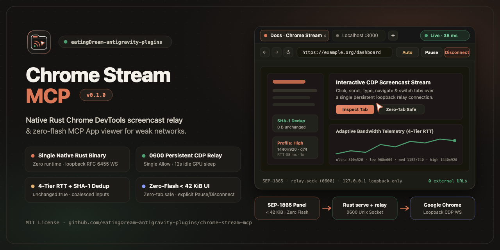
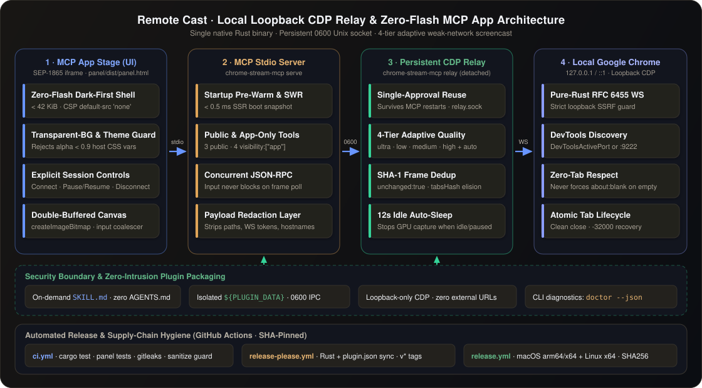

<div align="center">


# Chrome Stream MCP

**A single-binary native Rust Chrome DevTools screencast relay, interactive browser controller, and zero-flash MCP App viewer engineered for low-bandwidth and high-latency links.**

[](https://github.com/eatingDream-antigravity-plugins/chrome-stream-mcp/actions/workflows/ci.yml)
[](https://github.com/eatingDream-antigravity-plugins/chrome-stream-mcp/releases)
[](LICENSE)


English | [简体中文](README.zh-CN.md)



<sub>Dark editorial-warm SEP-1865 stage panel (&lt; 42 KiB, zero external URLs) backed by a persistent <code>0600</code> Unix-socket Rust CDP relay.</sub>

</div>

## Features

- **Single Native Rust Binary (`chrome-stream-mcp`)** — zero Node.js or Python runtime required at execution time; bundles a pure-Rust loopback RFC 6455 WebSocket client with SSRF guards, FIPS 180-4 SHA-1 frame hashing, a detached `0600` Unix-socket relay daemon, and a concurrent MCP stdio server.
- **Persistent `0600` Unix-Socket CDP Relay (`relay`)** — keeps Chrome's authorized DevTools WebSocket alive across MCP server restarts so you click **Allow** once per browser session, and automatically stops GPU screencasting after 12 seconds of inactivity.
- **Zero-Tab Respect & Resilient Tab Lifecycle** — respects zero open Chrome tabs without ever forcing `about:blank`, performs atomic tab close (evicting sessions and preserving the active tab on background-tab close), tracks `Target.targetDestroyed`, and transparently recovers from `-32000` (`No target with given id found`) races.
- **Explicit Connect, Pause & Disconnect** — opening the stage never auto-dials Chrome when disconnected; always-visible **Connect**, **Pause / Resume** (stops GPU capture while keeping the relay WebSocket authorized), and **Disconnect** (closes the CDP WebSocket to save battery) controls keep you in full command.
- **Weak-Network 4-Tier Quality + SHA-1 Deduplication** — adapts across four profiles (`ultra` 800×520 q32, `low` 960×600 q38, `medium` 1152×740 q52, `high` 1440×920 q74) from measured RTT (`auto`), returns `unchanged: true` (zero image bytes) when SHA-1 hashes match, elides unchanged tab lists (`tabsHash`), scales fallback screenshots (`clip.scale`), and dispatches coalesced non-blocking input batches.
- **Zero-Flash Dark-First UI (`panel/dist/panel.html`, < 42 KiB)** — self-contained SEP-1865 bundle (`default-src 'none'`, zero external URLs) with instant `< 0.5 ms` SWR boot hydration, transparent host CSS variable guards (ignoring empty / `transparent` / alpha `< 0.9` `--color-background-primary` values so iframes never flash white), double-buffered `createImageBitmap` rendering, and polling paused on `document.hidden`.

## Architecture

<p align="center"></p>

1. **MCP App Stage (`panel/dist/panel.html`)** renders inside the host's SEP-1865 iframe with dark-first styling, transparent-background protection, double-buffered canvas rendering, and input coalescing.
2. **MCP Stdio Server (`chrome-stream-mcp serve`)** handles concurrent JSON-RPC tool calls, pre-warms SWR boot snapshots in the background, separates public tools from `visibility: ["app"]` UI tools, and redacts sensitive fields before responses leave the process.
3. **Persistent CDP Relay (`chrome-stream-mcp relay`)** runs detached over a `0600` Unix domain socket (`relay.sock`), multiplexing fast inputs alongside frame long-polls, computing SHA-1 frame digests, adapting quality profiles, and sleeping GPU capture after 12s idle.
4. **Local Google Chrome (Loopback CDP)** connects strictly via `127.0.0.1` / `::1` discovered from `DevToolsActivePort` (or localhost port `9222` fallback) with atomic tab lifecycle and zero-tab respect.

## Quick Install

### One-line install (macOS arm64 / x86_64 & Linux x86_64)

Downloads the matching GitHub Release plugin archive, verifies its `SHA256` checksum, and installs cleanly into `${ANTIGRAVITY_PLUGINS_DIR:-$HOME/.gemini/config/plugins}/chrome-stream-mcp`:

```sh
curl -fsSL https://raw.githubusercontent.com/eatingDream-antigravity-plugins/chrome-stream-mcp/main/scripts/install.sh | sh
```

Pin a specific release tag if desired:

```sh
CHROME_STREAM_VERSION=v0.1.0 curl -fsSL https://raw.githubusercontent.com/eatingDream-antigravity-plugins/chrome-stream-mcp/main/scripts/install.sh | sh
```

### Build from source

Requirements: Rust toolchain (`cargo` 1.75+) and Node.js 20+ (only to bundle/test `panel/dist/panel.html`; zero npm dependencies required).

```bash
git clone https://github.com/eatingDream-antigravity-plugins/chrome-stream-mcp.git
cd chrome-stream-mcp

# 1. Build the self-contained panel bundle (< 42 KiB) and run panel tests
node panel/build.mjs
node --test panel/net-policy.test.mjs

# 2. Run the Rust unit + IPC + MCP stdio + SWR test suite
cargo test --locked

# 3. Build stripped, path-remapped LTO release binary
RUSTFLAGS="--remap-path-prefix=$HOME=/build" cargo build --release --locked
```

### Chrome remote debugging setup

1. Keep Google Chrome running on your local machine.
2. Open `chrome://inspect/#remote-debugging` in Chrome and enable remote debugging (or launch Chrome locally with `--remote-debugging-port=9222`).
3. Open Chrome Stream and click **Connect** (or call `chrome_stream_connect`), then click **Allow** once in Chrome's permission dialog. `chrome-stream-mcp relay` retains the authorized session across MCP restarts.
4. Verify your setup anytime with:

```bash
chrome-stream-mcp doctor --json
```

## Agent Integration & Skill

Chrome Stream ships an on-demand Agent skill at [`skills/chrome-stream/SKILL.md`](skills/chrome-stream/SKILL.md) and deliberately ships **no `rules/AGENTS.md`** and **no `hooks.json`** so it adds zero always-on context overhead.

### MCP Tools

| Tool | Visibility | Purpose |
| --- | --- | --- |
| `chrome_stream_stage` | Public + UI entrypoints | Open the Chrome Stream stage (`ui://chrome-stream-mcp/stage`) and report relay/Chrome status without auto-dialing |
| `chrome_stream_connect` | Public | Connect or verify the persistent local CDP relay session and warm the active tab screencast (`qualityPreset`, `rttMs`) |
| `chrome_stream_disconnect` | Public | Stop active screencasting and close the Chrome CDP WebSocket to save battery |
| `chrome_stream_tabs` | App-only (`["app"]`) | List, switch, open, or atomically close Chrome tabs with zero-tab respect |
| `chrome_stream_frame` | App-only (`["app"]`) | Long-poll next changed frame with SHA-1 dedup, `tabsHash` elision, and 4-tier adaptive quality |
| `chrome_stream_input` | App-only (`["app"]`) | Dispatch non-blocking coalesced click, mousemove, scroll, type, key, nav, pause/resume, or tab batches |
| `chrome_stream_navigate` | App-only (`["app"]`) | Navigate to a URL/search query or invoke browser back, forward, or reload |

## CLI Usage

```bash
# Start the MCP stdio JSON-RPC server (invoked by MCP hosts via mcp_config.json)
chrome-stream-mcp serve --data-dir "${PLUGIN_DATA}" --panel-html "${PLUGIN_ROOT}/panel/dist/panel.html"

# Start the detached persistent 0600 Unix-socket CDP relay daemon directly
chrome-stream-mcp relay

# Inspect Chrome DevToolsActivePort, port 9222 fallback, relay socket mode, and panel bundle
chrome-stream-mcp doctor
chrome-stream-mcp doctor --json
```

### Environment Variables

| Variable | Description | Default |
| --- | --- | --- |
| `CHROME_STREAM_DATA_DIR` | Directory holding `relay.sock` (`0600`) and `relay.pid` (`0600`) | `~/.gemini/antigravity/plugin_data/chrome-stream-mcp` |
| `CHROME_STREAM_RELAY_SOCK` | Explicit Unix domain socket path | `${CHROME_STREAM_DATA_DIR}/relay.sock` |
| `CHROME_STREAM_PANEL_HTML` | Explicit path to `panel/dist/panel.html` | Auto-resolved relative to binary |
| `CHROME_STREAM_CHROME_PORT_FILE` | Override path to Chrome's `DevToolsActivePort` | OS default Chrome profile dir |
| `CHROME_STREAM_CHROME_DEBUG_PORT` | Fallback localhost remote-debugging port | `9222` |

## Security & Privacy Boundary

- **Loopback-Only SSRF Guard** — the built-in RFC 6455 WebSocket client refuses any non-loopback target (`127.0.0.1` / `::1` only). Never expose Chrome's remote debugging port on `0.0.0.0`.
- **`0600` Isolated Local IPC** — `relay.sock` and `relay.pid` are created exclusively inside the plugin data directory with `0600` owner-only permissions.
- **Automatic Payload Redaction** — `redact_relay_payload` strips local filesystem paths (`portFile.path`), DevTools WebSocket tokens (`portFile.wsUrl`), and personal hostnames before returning tool JSON.
- **Strict Panel CSP & Clean Binaries** — `panel/dist/panel.html` contains zero external URLs (compatible with `default-src 'none'`), release binaries are built with `RUSTFLAGS="--remap-path-prefix=$HOME=/build"` (zero local paths in `strings`), downloads are SHA256-verified, and CI enforces `gitleaks` over full git history plus `scripts/check_sanitized.sh`.

## Project Structure

```text
chrome-stream-mcp/
├── src/
│   ├── main.rs                 # CLI entrypoint: serve, relay, doctor [--json]
│   ├── config.rs               # Paths, env overrides, OS DevToolsActivePort resolution
│   ├── cdp/                    # Pure-Rust RFC 6455 WS client, loopback SSRF guard, discovery
│   ├── mcp/                    # Concurrent stdio server, SWR pre-warm, tool dispatch & redaction
│   ├── relay/                  # Persistent 0600 Unix-socket daemon & multiplexed IPC client
│   └── stream/                 # 4-tier quality profiles, FIPS 180-4 SHA-1 frame & tab dedup
├── panel/
│   ├── bridge.js               # Lightweight SEP-1865 bridge + transparent-bg & luminance guards
│   ├── net-policy.js           # RTT quality controller, input coalescing, epoch guards
│   ├── stage.js                # Zero-flash UI, double-buffered canvas, Pause/Disconnect controls
│   ├── styles.css              # Editorial-warm dark-first tokens & light theme overrides
│   ├── template.html           # Dark-first HTML shell with synchronous SSR boot slot
│   ├── build.mjs               # Zero-dependency bundler (< 42 KiB gate)
│   ├── net-policy.test.mjs     # Node test suite (policy, bundle invariants, transparent-bg guard)
│   └── dist/panel.html         # Pre-built self-contained MCP App bundle
├── skills/chrome-stream/
│   └── SKILL.md                # On-demand Agent skill (zero always-on rules/AGENTS.md)
├── assets/logo.svg             # Editorial-warm vector icon
├── docs/                       # Architecture SVGs (EN / zh-CN) & 1280×640 social preview
├── scripts/
│   ├── install.sh              # POSIX installer with SHA256 verification & atomic binary swap
│   └── check_sanitized.sh      # Pre-push sanitization guard
├── .github/workflows/          # SHA-pinned CI, Release Please, and cross-platform Release CI
├── plugin.json                 # Antigravity plugin manifest
├── mcp_config.json             # MCP stdio server definition
├── CHANGELOG.md
├── CONTRIBUTING.md
├── SECURITY.md
└── LICENSE                     # MIT
```

## Contributing & License

Pull requests are welcome — see [CONTRIBUTING.md](CONTRIBUTING.md) for branch conventions and local verification checks, and [CHANGELOG.md](CHANGELOG.md) for release history. Please report security vulnerabilities privately per [SECURITY.md](SECURITY.md).

Licensed under the [MIT License](LICENSE).
