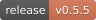
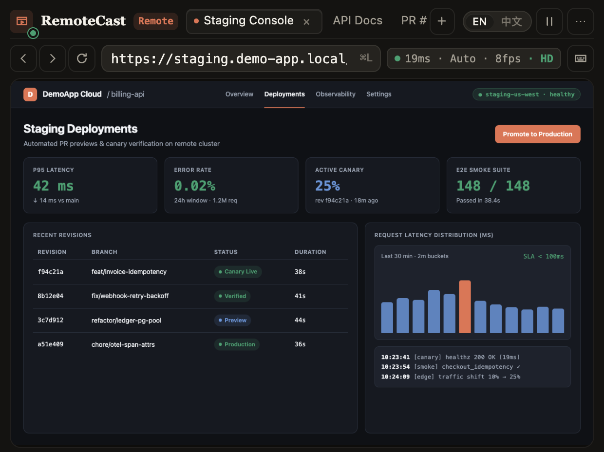

<div align="center">


# Remote Cast (`chrome-stream-mcp`)

**View and click through your local Chrome tabs inside Antigravity — crisp and responsive even over slow mobile or remote links.**

[Homepage](https://remotecast.eatingdream.dev) · English | [简体中文](README.zh-CN.md) · [Releases](https://github.com/eatingDream-antigravity-plugins/remote-cast/releases) · [AI Guide](docs/ai-guide.md) · [`llms.txt`](llms.txt)

[](https://github.com/eatingDream-antigravity-plugins/remote-cast/actions/workflows/ci.yml)
[](https://github.com/eatingDream-antigravity-plugins/remote-cast/releases)

[](LICENSE)


<picture>
  <source media="(prefers-color-scheme: dark)" srcset="docs/images/remotecast-connected-dark.png">
  <source media="(prefers-color-scheme: light)" srcset="docs/images/remotecast-connected-light.png">
  
</picture>

</div>

## Is It For You?

- **Use Remote Cast** if you want to view, scroll, type, and switch tabs in your own local Google Chrome (with your existing logins and extensions) or an isolated loopback Chrome right inside Antigravity, even when working remotely over a slow connection.
- **Skip it** if you only want an AI agent to browse or scrape the web autonomously — Antigravity's built-in `browser` subagent already handles general browsing without touching your personal Chrome.

## Why Remote Cast

- **Your real Chrome or one-click isolated Chrome**: Attach to your daily Chrome profile with logins intact, or launch an isolated loopback Chrome profile that never asks for a local **Allow** click.
- **Standby keeps your connection alive remotely**: Hit **Standby** in the header to drop streaming to 0 FPS and save battery without losing Chrome's **Allow** consent across reloads; **Revoke & Disconnect** sits safely in the `⋯` menu.
- **Stays readable on weak links, snaps sharp when you stop**: Adapts frame rate smoothly without quality flicker while scrolling or typing, then settles into a sharp WebP still frame with zero wasted bytes when the page is idle.
- **No misdirected clicks or forced blank tabs**: Every click and keystroke stays locked to the tab you were looking at, and closing the last tab shows a clean empty state instead of spawning `about:blank`.
- **Fast, lightweight native panel**: Single Rust binary with a zero-dependency panel (`< 45 KB`), dark-first zero-flicker loading, and instant EN / 中文 switching.

## Quick Start

### 1. Install (macOS & Linux)

```sh
curl -fsSL https://raw.githubusercontent.com/eatingDream-antigravity-plugins/remote-cast/main/scripts/install.sh | sh
```

<sub>Downloads the prebuilt binary from GitHub Releases, verifies its SHA-256 checksum, and installs into <code>~/.gemini/config/plugins/chrome-stream-mcp</code>. Uninstall anytime with <code>curl -fsSL https://raw.githubusercontent.com/eatingDream-antigravity-plugins/remote-cast/main/scripts/install.sh | sh -s -- --uninstall</code>.</sub>

Reload Antigravity after installation.

### 2. Connect Chrome

- **Personal Chrome**: Enable remote debugging at `chrome://inspect/#remote-debugging`, open **Remote Cast**, click **Connect Personal Chrome**, and confirm **Allow** once in Chrome. Use **Standby** when pausing so you never have to re-approve remotely.
- **Remote Chrome (No Allow)**: Click **Launch Remote Chrome** for a fresh, isolated loopback profile (`0700` permissions on `127.0.0.1`). If port `9222` is busy, set `CHROME_STREAM_DEBUG_PORT` to a free port or connect Personal Chrome.

## For AI Agents

Machine-readable tool schemas, environment variables, CLI diagnostics, and stdio setup for any MCP-capable agent:

```sh
npx skills add eatingDream-antigravity-plugins/remote-cast
```

- **Agent Skill**: [`skills/chrome-stream/SKILL.md`](skills/chrome-stream/SKILL.md)
- **Full AI & Configuration Guide**: [`docs/ai-guide.md`](docs/ai-guide.md)
- **LLM Entry Index**: [`llms.txt`](llms.txt)

> Prompt hint: *"Read `llms.txt` and `docs/ai-guide.md` in `chrome-stream-mcp` to run `chrome-stream-mcp doctor --json` or connect Chrome in standby/remote mode."*

## Safety & Privacy

- **Loopback-only (`127.0.0.1` / `::1`)**: Rejects non-loopback endpoints and never exposes Chrome debugging ports to your LAN or the internet.
- **Same-user local socket**: Uses a `0600` Unix socket, checks peer user ID, and verifies ownership and permissions before touching sockets or the `0700` isolated profile.
- **Explicit connect & 12 s idle pause**: Opening the panel never auto-connects to Chrome; screen capture automatically pauses after 12 seconds of inactivity and wakes on your next click or key.
- **Sanitized diagnostics**: `chrome-stream-mcp doctor --json` omits local paths and raw debugging WebSocket URLs by default.

## Documentation

- [AI Guide & Configuration Reference](docs/ai-guide.md) — MCP tools, environment variables, CLI subcommands, build from source
- [Agent Skill](skills/chrome-stream/SKILL.md) — On-demand agent workflow rules
- [LLM Index](llms.txt) · [Contributor Guide](AGENTS.md) · [Contributing](CONTRIBUTING.md) · [Changelog](CHANGELOG.md) · [Security](SECURITY.md)

## Antigravity Plugin Suite

Part of the [eatingDream Antigravity Plugin Suite](https://eatingdream.dev): [Context Radar](https://github.com/eatingDream-antigravity-plugins/context-radar) (`context-radar-mcp`) · [Clam Guard](https://github.com/eatingDream-antigravity-plugins/clam-guard) (`mac-clamshell-mcp`) · **Remote Cast** (`chrome-stream-mcp`) · [Colab Deck](https://github.com/eatingDream-antigravity-plugins/colab-deck) (`colab-mcp`) — powered by [Panel Kit](https://github.com/eatingDream-antigravity-plugins/panel-kit) (`agy-mcp-kit`).

## License

Licensed under the [MIT License](LICENSE).
