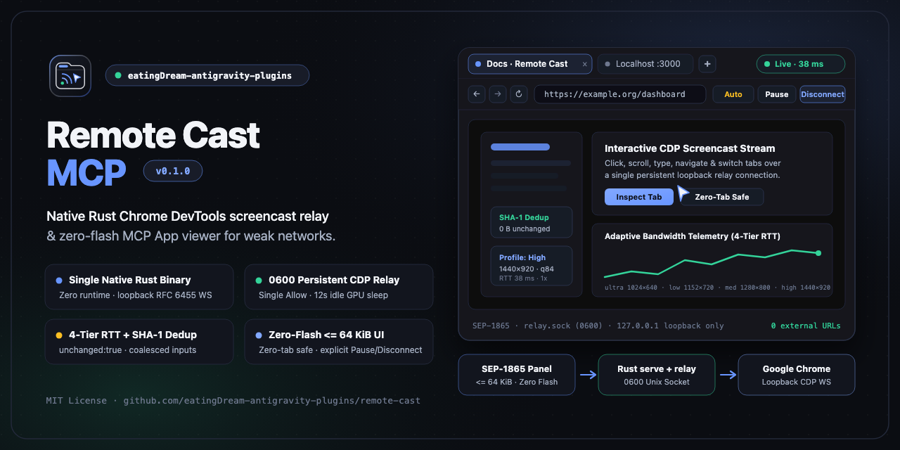

<div align="center">


# Chrome Stream MCP

**在 Antigravity 内实时查看和操作本机 Google Chrome —— 即使手机远程或弱网环境下，依然清晰跟手。**

[English](README.md) | 简体中文 · [Releases](https://github.com/eatingDream-antigravity-plugins/chrome-stream-mcp/releases) · [AI 使用指南](docs/ai-guide.md) · [`llms.txt`](llms.txt)

[](https://github.com/eatingDream-antigravity-plugins/chrome-stream-mcp/actions/workflows/ci.yml)
[](https://github.com/eatingDream-antigravity-plugins/chrome-stream-mcp/releases)

[](LICENSE)




</div>

## 概览

Chrome Stream 通过 Rust 本地中继和 SEP-1865 MCP App，在 Antigravity 中传输本机 Chrome 画面，并提供输入和标签页控制。Chrome 调试流量仅使用环回地址（`127.0.0.1` 和 `::1`）。

## 核心特性

- **日常 Chrome 与一键独立远程 Chrome 双模式**：可复用你现有的 Chrome（保留已登录账号与扩展），也可一键启动独立回环远程 Chrome（免本机点 **Allow**）。
- **休眠保活，远程不重弹 Allow**：顶栏主按钮为 **休眠 / 唤醒**（0 FPS 停流但保持已授权连接存活）；会撤销授权的 **彻底断开 · 撤销授权** 收纳于 `⋯` 菜单并附明确警告。
- **弱网渐进高清**：滑动/打字时守住文字清晰下限，停手约 380 ms 自动补发一张高清 WebP 静帧，静止期间 0 字节去重。
- **抗抖动自适应调度**：基于 EWMA RTT 平滑与非对称迟滞（连续 2 次慢才降档、连续 3 次快才升档），弱网不抖动、滚轮与点击更跟手。
- **标签纪元防误触与干净空态**：所有页面输入绑定明确标签纪元，后台切页绝不误点错标签；关闭最后一个标签页展示干净空态，不强弹 `about:blank`。
- **Editorial-Warm 极简面板**：暗色优先零闪屏、零外部依赖单文件面板（`< 43.5 KB`），严格 `default-src 'none'` CSP，支持中英双语即时切换。

## 快速开始

### 1. 一键安装（macOS 与 Linux）

```sh
curl -fsSL https://raw.githubusercontent.com/eatingDream-antigravity-plugins/chrome-stream-mcp/main/scripts/install.sh | sh
```

安装完成后重载 Antigravity 即可生效。

### 2. 连接 Chrome

- **连接日常 Chrome**仅使用 Chrome 的 `DevToolsActivePort` 文件。先在 `chrome://inspect/#remote-debugging` 启用远程调试，再在 Antigravity 中打开 **Chrome Stream**。点击 **连接日常 Chrome**，然后在 Chrome 中确认 **Allow**。点击 **休眠**可保留已授权的连接。
- **独立远程 Chrome（免 Allow）**在 `127.0.0.1` 启动，使用权限为 `0700` 的隔离配置目录。只有正在运行的浏览器端点与该目录匹配时，启动操作才会复用它。如果端口已被占用，请用 `CHROME_STREAM_DEBUG_PORT` 指定空闲端口，或连接日常 Chrome。

## AI Agent 专属指引

完整的 MCP 工具参数表、`CHROME_STREAM_*` 环境变量、CLI 诊断命令与跨客户端 stdio 配置已整理至面向 Agent 的文档中：

- **通用 Skill（`agentskills.io`）**：[`skills/chrome-stream/SKILL.md`](skills/chrome-stream/SKILL.md)（或运行 `npx skills add eatingDream-antigravity-plugins/chrome-stream-mcp`）
- **完整 AI 与配置参考**：[`docs/ai-guide.md`](docs/ai-guide.md)
- **LLM 索引入口**：[`llms.txt`](llms.txt)

> 提示词示例：*「阅读 `chrome-stream-mcp` 的 `llms.txt` 和 `docs/ai-guide.md`，帮我配置 stdio MCP、运行 `chrome-stream-mcp doctor --json`，或以休眠/独立远程模式接入 Chrome。」*

## 安全与隐私边界

- **严格环回（`127.0.0.1` / `::1`）**：拒绝一切非本机地址，绝不将 Chrome 调试端口暴露至局域网或公网。
- **本地访问控制**使用权限为 `0600` 的 Unix 套接字，并验证对端用户 ID。中继在使用套接字和权限为 `0700` 的 Chrome 配置目录前检查目录所有者和写权限。
- **显式连接与 12 秒空闲停流**：打开面板不自动连接；12 秒无交互自动暂停抓屏护显卡，下次交互立即唤醒。
- **诊断脱敏**。`chrome-stream-mcp doctor --json` 默认省略本机文件路径和原始 DevTools WebSocket URL。
- **MCP Apps 能力**。宿主协商 MCP App MIME 类型后，`resources/read` 会返回包含标签页和像素的启动快照。其他宿主收到静态面板 HTML。

## 相关文档

- [AI 指南与配置手册](docs/ai-guide.md) — MCP 工具完整规格、环境变量、CLI 子命令、源码构建
- [Agent Skill](skills/chrome-stream/SKILL.md) — 按需加载的 Agent 操作规范
- [LLM 索引](llms.txt) · [协作规范](AGENTS.md) · [贡献指南](CONTRIBUTING.md) · [更新日志](CHANGELOG.md) · [安全策略](SECURITY.md)

## 许可证

基于 [MIT License](LICENSE) 开源。
