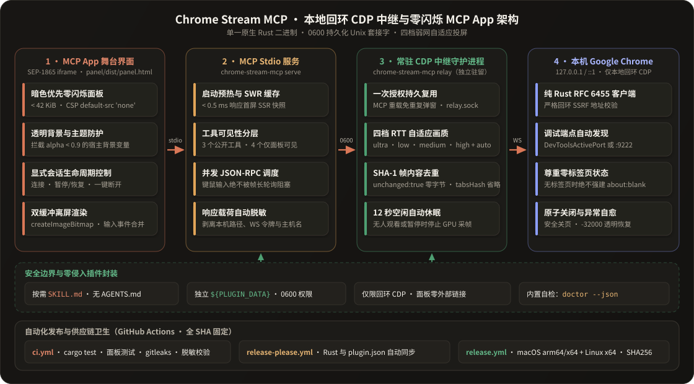

<div align="center">


# Chrome Stream MCP

**专为弱网与高延迟链路设计的单二进制原生 Rust Chrome DevTools 投屏中继、交互式标签页控制器与零闪烁 MCP App 面板。**

[](https://github.com/eatingDream-antigravity-plugins/chrome-stream-mcp/actions/workflows/ci.yml)
[](https://github.com/eatingDream-antigravity-plugins/chrome-stream-mcp/releases)
[](LICENSE)


[English](README.md) | 简体中文


<sub>暗色暖编排 SEP-1865 舞台面板（&lt; 42 KiB、零外部链接），由持久化 <code>0600</code> Unix 套接字 Rust CDP 中继驱动。</sub>

</div>

## 核心特性

- **单一原生 Rust 二进制（`chrome-stream-mcp`）**：运行时零 Node.js / Python 依赖；内置带 SSRF 防护的纯 Rust 本地回环 RFC 6455 WebSocket 客户端、FIPS 180-4 SHA-1 帧哈希、独立驻留的 `0600` Unix 套接字中继守护进程与并发 MCP stdio 服务。
- **持久化 `0600` Unix 套接字 CDP 中继（`relay`）**：跨 MCP 服务重启保持已授权的 Chrome DevTools WebSocket 连接，同一浏览器会话只需点一次 **Allow（允许）**；无操作 12 秒后自动停止 GPU 投屏采样以降低功耗。
- **尊重零标签页与高韧性标签生命周期**：当 Chrome 无打开标签页时绝不强行创建 `about:blank`；原子级关闭标签页（先停帧并清理会话、关后台页不打断当前活动页），监听 `Target.targetDestroyed` 并在 `-32000`（`No target with given id found`）竞态时透明自愈。
- **显式连接、暂停与断开控制**：未连接状态下打开面板绝不自动拨号 Chrome；工具栏常驻 **Connect（连接）**、**Pause / Resume（暂停 / 恢复，停止 GPU 采帧但保留已授权中继连接）** 与 **Disconnect（彻底断开 CDP WebSocket 省电）**。
- **弱网四档自适应画质 + SHA-1 帧去重**：依据实测 RTT 自动切换四档规格（`ultra` 800×520 q32、`low` 960×600 q38、`medium` 1152×740 q52、`high` 1440×920 q74）；像素未变时返回 `unchanged: true`（零图像字节），标签列表未变时省略 `tabsHash` 传输，回退截屏按 `clip.scale` 缩放，键鼠输入经合并后非阻塞并发下发。
- **暗色优先零闪烁 UI（`panel/dist/panel.html`，< 42 KiB）**：自包含 SEP-1865 单文件面板（兼容 `default-src 'none'`、零外部 URL），支持 `< 0.5 ms` SWR 启动注水、宿主透明背景 CSS 变量拦截（忽略空值 / `transparent` / alpha `< 0.9` 的 `--color-background-primary`，杜绝白屏闪烁）、`createImageBitmap` 双缓冲渲染，并在 `document.hidden` 时自动暂停轮询。

## 架构

<p align="center"></p>

1. **MCP App 舞台界面（`panel/dist/panel.html`）**：运行在宿主 SEP-1865 iframe 内，采用暗色优先与透明背景变量防护、双缓冲离屏画布渲染及输入事件合并。
2. **MCP Stdio 服务（`chrome-stream-mcp serve`）**：并发处理 JSON-RPC 工具调用，后台预热 SWR 启动快照，严格区分公开工具与 `visibility: ["app"]` 面板专用工具，并在返回前自动脱敏敏感字段。
3. **常驻 CDP 中继守护进程（`chrome-stream-mcp relay`）**：通过 `0600` Unix 域套接字（`relay.sock`）独立驻留，多路复用快速键鼠输入与帧长轮询，负责 SHA-1 内容去重、四档画质调节与 12 秒空闲自动休眠。
4. **本机 Google Chrome（回环 CDP）**：仅通过 `127.0.0.1` / `::1` 连接 `DevToolsActivePort`（或回退本机 `9222` 端口），保持原子级标签生命周期并完整尊重零标签页状态。

## 快速安装

### 一键安装（macOS arm64 / x86_64 与 Linux x86_64）

自动下载匹配当前系统与架构的 GitHub Release 插件归档，校验 `SHA256` 后原子安装到 `${ANTIGRAVITY_PLUGINS_DIR:-$HOME/.gemini/config/plugins}/chrome-stream-mcp`：

```sh
curl -fsSL https://raw.githubusercontent.com/eatingDream-antigravity-plugins/chrome-stream-mcp/main/scripts/install.sh | sh
```

如需指定版本标签：

```sh
CHROME_STREAM_VERSION=v0.1.0 curl -fsSL https://raw.githubusercontent.com/eatingDream-antigravity-plugins/chrome-stream-mcp/main/scripts/install.sh | sh
```

### 从源码构建

环境要求：Rust 工具链（`cargo` 1.75+）与 Node.js 20+（仅用于打包与测试 `panel/dist/panel.html`，零 npm 第三方依赖）。

```bash
git clone https://github.com/eatingDream-antigravity-plugins/chrome-stream-mcp.git
cd chrome-stream-mcp

# 1. 构建自包含面板（< 42 KiB）并运行面板单测
node panel/build.mjs
node --test panel/net-policy.test.mjs

# 2. 运行 Rust 单元 + IPC + MCP stdio + SWR 集成测试
cargo test --locked

# 3. 构建去符号、路径重映射的 LTO Release 二进制
RUSTFLAGS="--remap-path-prefix=$HOME=/build" cargo build --release --locked
```

### Chrome 远程调试配置

1. 在本机保持 Google Chrome 处于运行状态。
2. 在 Chrome 地址栏打开 `chrome://inspect/#remote-debugging` 并开启远程调试（或在本地使用 `--remote-debugging-port=9222` 启动 Chrome）。
3. 打开 Chrome Stream 面板并点击 **Connect**（或调用 `chrome_stream_connect`），在 Chrome 首次弹出的授权对话框中点击 **Allow（允许）**。此后 `chrome-stream-mcp relay` 会持久保持该连接。
4. 随时可执行以下命令自检环境：

```bash
chrome-stream-mcp doctor --json
```

## Agent 集成与技能

Chrome Stream 提供按需加载的 Agent 技能文档 [`skills/chrome-stream/SKILL.md`](skills/chrome-stream/SKILL.md)，**不包含 `rules/AGENTS.md` 或 `hooks.json`**，对 Agent 常驻上下文保持零侵入。

### MCP 工具一览

| 工具名 | 可见性 | 用途 |
| --- | --- | --- |
| `chrome_stream_stage` | 公开 + UI 入口 | 打开 Chrome Stream 舞台界面（`ui://chrome-stream-mcp/stage`）并上报当前连接状态（未连接时不自动拨号） |
| `chrome_stream_connect` | 公开 | 建立或校验本地持久化 CDP 中继会话并预热活动标签页投屏（支持 `qualityPreset`、`rttMs`） |
| `chrome_stream_disconnect` | 公开 | 停止活跃投屏并关闭 Chrome CDP WebSocket 以节省电量 |
| `chrome_stream_tabs` | 仅面板可见（`["app"]`） | 列出、切换、新建或原子关闭标签页（尊重零标签页状态） |
| `chrome_stream_frame` | 仅面板可见（`["app"]`） | 长轮询下一变化帧，支持 SHA-1 去重、`tabsHash` 省略与四档自适应画质 |
| `chrome_stream_input` | 仅面板可见（`["app"]`） | 非阻塞下发合并后的点击、移动、滚动、输入、按键、导航、暂停/恢复与标签操作批次 |
| `chrome_stream_navigate` | 仅面板可见（`["app"]`） | 导航至 URL / 搜索词，或执行后退、前进与刷新 |

## CLI 用法

```bash
# 启动 MCP stdio JSON-RPC 服务（由 MCP 宿主按 mcp_config.json 拉起）
chrome-stream-mcp serve --data-dir "${PLUGIN_DATA}" --panel-html "${PLUGIN_ROOT}/panel/dist/panel.html"

# 直接启动独立的 0600 Unix 套接字持久化 CDP 中继守护进程
chrome-stream-mcp relay

# 诊断 Chrome DevToolsActivePort、9222 回退端口、中继套接字权限与面板构建状态
chrome-stream-mcp doctor
chrome-stream-mcp doctor --json
```

### 环境变量

| 变量 | 说明 | 默认值 |
| --- | --- | --- |
| `CHROME_STREAM_DATA_DIR` | 存放 `relay.sock`（`0600`）与 `relay.pid`（`0600`）的数据目录 | `~/.gemini/antigravity/plugin_data/chrome-stream-mcp` |
| `CHROME_STREAM_RELAY_SOCK` | 显式指定 Unix 域套接字路径 | `${CHROME_STREAM_DATA_DIR}/relay.sock` |
| `CHROME_STREAM_PANEL_HTML` | 显式指定 `panel/dist/panel.html` 路径 | 相对二进制自动定位 |
| `CHROME_STREAM_CHROME_PORT_FILE` | 覆盖 Chrome `DevToolsActivePort` 文件路径 | 按操作系统默认 Chrome 目录 |
| `CHROME_STREAM_CHROME_DEBUG_PORT` | 本机远程调试回退端口 | `9222` |

## 安全与隐私边界

- **仅限本地回环的 SSRF 防护**：内置 RFC 6455 WebSocket 客户端拒绝任何非回环目标（仅允许 `127.0.0.1` / `::1`）。请勿将 Chrome 远程调试端口暴露到 `0.0.0.0`。
- **`0600` 隔离本地 IPC**：`relay.sock` 与 `relay.pid` 仅创建在插件数据目录下，权限严格限定为 `0600`（仅当前用户可读写）。
- **响应载荷自动脱敏**：`redact_relay_payload` 会在工具结果返回前自动剥离本机路径（`portFile.path`）、DevTools WebSocket 令牌（`portFile.wsUrl`）与个人主机名。
- **严格面板 CSP 与干净发布产物**：`panel/dist/panel.html` 零外部链接（兼容 `default-src 'none'`），发布二进制经 `RUSTFLAGS="--remap-path-prefix=$HOME=/build"` 编译（`strings` 无本机路径残留），一键安装脚本强制验证 `SHA256`，CI 对完整 Git 历史执行 `gitleaks` 与 `scripts/check_sanitized.sh` 检查。

## 项目结构

```text
chrome-stream-mcp/
├── src/
│   ├── main.rs                 # CLI 入口：serve、relay、doctor [--json]
│   ├── config.rs               # 路径、环境变量与各平台 DevToolsActivePort 解析
│   ├── cdp/                    # 纯 Rust RFC 6455 WS 客户端、回环 SSRF 防护与发现
│   ├── mcp/                    # 并发 stdio 服务、SWR 预热、工具分发与载荷脱敏
│   ├── relay/                  # 持久化 0600 Unix 套接字守护进程与多路复用 IPC
│   └── stream/                 # 四档画质配置、FIPS 180-4 SHA-1 帧与标签去重
├── panel/
│   ├── bridge.js               # 轻量 SEP-1865 桥接与透明背景 / 亮度防护
│   ├── net-policy.js           # RTT 画质控制器、输入合并与帧 epoch 校验
│   ├── stage.js                # 零闪烁舞台 UI、双缓冲画布与暂停/断开控制
│   ├── styles.css              # 暖编排暗色优先样式与浅色主题覆写
│   ├── template.html           # 暗色优先 HTML 外壳与同步 SSR 启动插槽
│   ├── build.mjs               # 零依赖打包器（< 42 KiB 体积门禁）
│   ├── net-policy.test.mjs     # Node 单测（弱网策略、打包约束、透明背景防护）
│   └── dist/panel.html         # 预构建自包含 MCP App 单文件面板
├── skills/chrome-stream/
│   └── SKILL.md                # 按需加载的 Agent 技能（零常驻 rules/AGENTS.md）
├── assets/logo.svg             # 暖编排矢量图标
├── docs/                       # 中英文架构图 SVG 与 1280×640 社交预览图
├── scripts/
│   ├── install.sh              # 带 SHA256 校验与原子替换的 POSIX 安装脚本
│   └── check_sanitized.sh      # 推送前脱敏守卫脚本
├── .github/workflows/          # 全 SHA 固定的 CI、Release Please 与跨平台发布流水线
├── plugin.json                 # Antigravity 插件清单
├── mcp_config.json             # MCP stdio 服务配置
├── CHANGELOG.md
├── CONTRIBUTING.md
├── SECURITY.md
└── LICENSE                     # MIT
```

## 参与贡献与许可

欢迎提交 Pull Request —— 分支规范与本地检查详见 [CONTRIBUTING.md](CONTRIBUTING.md)，版本演进见 [CHANGELOG.md](CHANGELOG.md)。如发现安全漏洞，请按 [SECURITY.md](SECURITY.md) 私下报告。

基于 [MIT 许可证](LICENSE) 开源。
