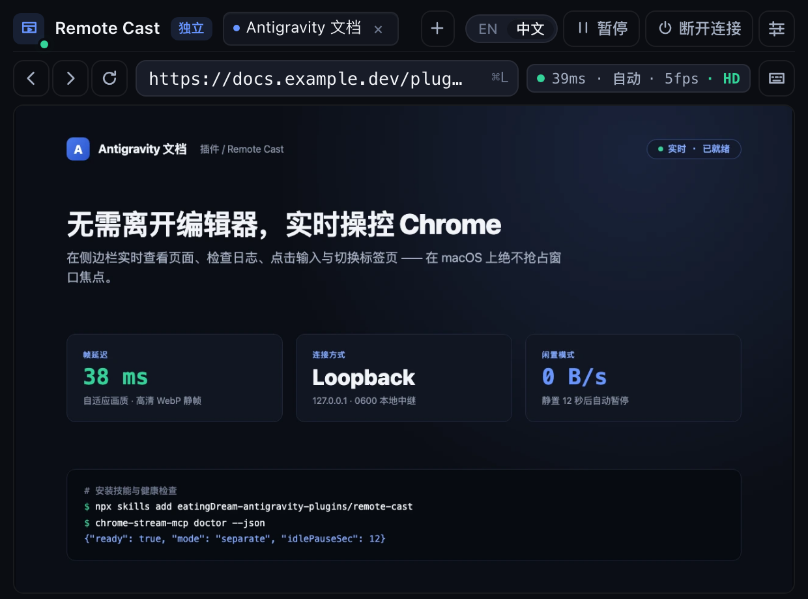

<div align="center">


# Remote Cast (`chrome-stream-mcp`)

**你的 Chrome，实时显示在 Antigravity 里。**

Remote Cast 把 Chrome 标签页实时投屏到侧边栏面板，让你边看边操作 —— 点击、输入、切换标签页。可以连接日常 Chrome，也可以打开独立的干净配置；画质会跟随网速自动调整。

[主页](https://remotecast.eatingdream.dev) · [English](README.md) | **简体中文** · [Releases](https://github.com/eatingDream-antigravity-plugins/remote-cast/releases) · [AI 使用指南](docs/ai-guide.md) · [`llms.txt`](llms.txt)

[](https://github.com/eatingDream-antigravity-plugins/remote-cast/actions/workflows/ci.yml)
[](https://github.com/eatingDream-antigravity-plugins/remote-cast/releases)

[](LICENSE)


<picture>
  <source media="(prefers-color-scheme: dark)" srcset="docs/images/remotecast-connected-dark-zh.png">
  <source media="(prefers-color-scheme: light)" srcset="docs/images/remotecast-connected-light-zh.png">
  
</picture>

</div>

## 适合你吗？

- **适合使用 Remote Cast**：你想在 Antigravity 侧边栏里直接查看、滚动、输入和切换自己电脑上的 Chrome 标签页（保留已有登录态和扩展），或者在弱网下使用独立的干净 Chrome 配置。
- **不需要安装**：如果你只是想让 AI 自己去浏览网页或跑自动化操作，直接用 Antigravity 内置的 `browser` 子代理即可，不需要接入个人 Chrome。

## 为什么选择 Remote Cast

- **日常 Chrome 与独立 Chrome 双模式**：可直接连接正在使用的日常 Chrome（保留账号登录和扩展），也可以一键打开独立 Chrome，使用全新配置且无需授权弹窗。
- **顶栏清晰区分「暂停」与「断开连接」**：点击 **暂停** 可立刻降到 0 FPS 省电并保持连接（不会丢掉 Chrome 授权）；需要结束会话时直接点 **断开连接**。
- **不抢 macOS 窗口焦点**：点击画面、切换标签页或新建标签页（`chrome://newtab`）都在后台静默完成，不会把 Chrome 窗口弹到 Antigravity 前面。
- **弱网省流、停手即高清**：提供 **自动 · 省流 · 流畅 · 均衡 · 高清** 五档画质。滚动和输入时流畅跟手，停手后自动补发高清静帧，画面无变化时零流量消耗。
- **面板内直接设置**：点右上角设置按钮即可调整语言、默认画质、默认连接方式、后台刷新和闲置暂停，配置写入 `settings.json` 并支持热加载。
- **轻量快速**：单个 Rust 二进制加零依赖单文件面板（`<= 64 KiB`），暗色优先无白屏闪烁，支持中英双语即时切换。

## 快速开始

### 1. 一键安装（macOS 与 Linux）

```sh
curl -fsSL https://raw.githubusercontent.com/eatingDream-antigravity-plugins/remote-cast/main/scripts/install.sh | sh
```

<sub>自动校验 SHA-256 并安装到 <code>~/.gemini/config/plugins/chrome-stream-mcp</code>；在 Antigravity 内运行会自动热重载 MCP 服务（外部终端可加 <code>--reload</code>，跳过可加 <code>--no-reload</code>，卸载可加 <code>--uninstall</code>）。</sub>

### 2. 连接 Chrome

- **日常 Chrome**：先在 Chrome 中打开 `chrome://inspect/#remote-debugging` 开启远程调试，在 Remote Cast 中点 **连接日常 Chrome**，并在 Chrome 弹窗里点一次「允许」。暂时不用时点 **暂停** 即可保持连接。
- **独立 Chrome**：点 **打开独立 Chrome**，将在 `127.0.0.1` 启动权限为 `0700` 的隔离配置目录，无需授权弹窗，并自动避开日常 Chrome 端口。

## AI Agent 专属指引

面向 Agent 的工具参数表、`settings.json` 配置项、CLI 诊断命令和 stdio 配置文档：

```sh
npx skills add eatingDream-antigravity-plugins/remote-cast
```

- **通用 Skill**：[`skills/chrome-stream/SKILL.md`](skills/chrome-stream/SKILL.md)
- **完整 AI 与配置指南**：[`docs/ai-guide.md`](docs/ai-guide.md)
- **LLM 索引入口**：[`llms.txt`](llms.txt)

## 安全与隐私边界

- **严格环回（`127.0.0.1` / `::1`）**：拒绝所有非本机地址，绝不将 Chrome 调试端口暴露到局域网或公网。
- **同用户本地访问控制**：使用 `0600` 权限的 Unix 套接字并校验对端用户 ID；读写套接字、`settings.json`（`0600`）和 `0700` 独立配置目录前均校验所有者与权限。
- **显式连接与闲置暂停**：打开面板不会自动连接 Chrome；闲置（默认 12 秒）自动暂停抓屏，下次点击或按键瞬间恢复。
- **诊断信息默认脱敏**：`chrome-stream-mcp doctor --json` 默认隐藏本机文件路径和原始调试 WebSocket 地址。

## 相关文档

- [AI 指南与配置手册](docs/ai-guide.md) — MCP 工具完整规格、`settings.json`、环境变量、CLI 子命令、源码构建
- [Agent Skill](skills/chrome-stream/SKILL.md) — 按需加载的 Agent 操作规范
- [LLM 索引](llms.txt) · [协作规范](AGENTS.md) · [贡献指南](CONTRIBUTING.md) · [更新日志](CHANGELOG.md) · [安全策略](SECURITY.md)

## Antigravity 插件套件

隶属于 [Antigravity Plugins](https://github.com/eatingDream-antigravity-plugins) 套件：[Context Radar](https://github.com/eatingDream-antigravity-plugins/context-radar) · [Clam Guard](https://github.com/eatingDream-antigravity-plugins/clam-guard) · **Remote Cast** · [Colab Deck](https://github.com/eatingDream-antigravity-plugins/colab-deck) · [Panel Kit](https://github.com/eatingDream-antigravity-plugins/panel-kit)

## 许可证

基于 [MIT License](LICENSE) 开源。
